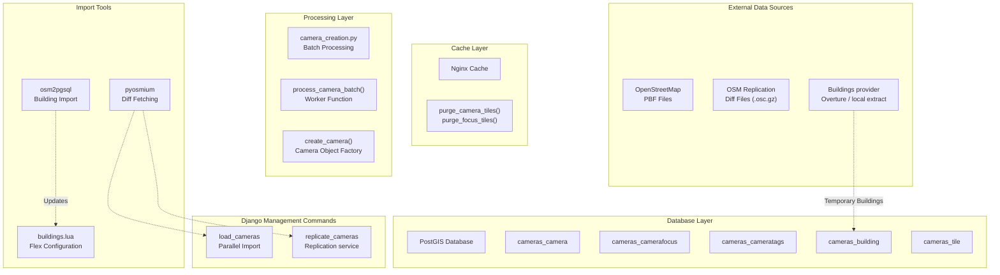
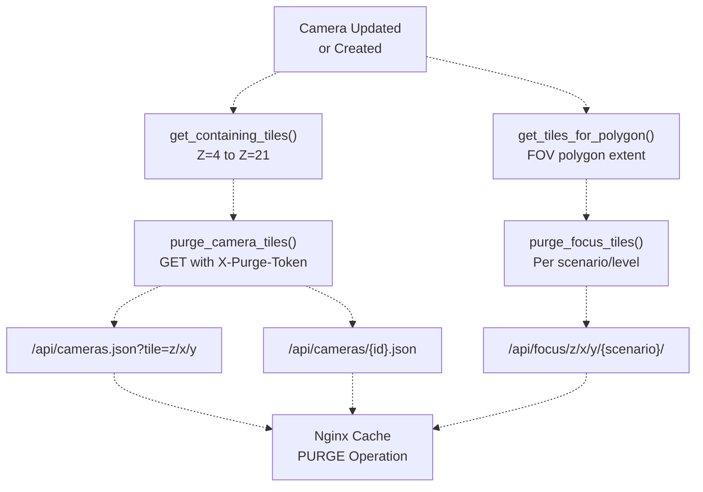

# Data import and management
{: .no_toc }

## Table of contents
{: .no_toc .text-delta }

- TOC
{:toc}

---

This document provides a high-level overview of PanoptiCity's data import and management system, including the strategies, components, and workflows for synchronizing surveillance camera data from OpenStreetMap (OSM). 

---

## Import strategy overview

The initial import and the continuous updates use different strategies to get the buildings needed by FOV (Field of View) calculations.

### Initial import

`osm2pgsql` imports into the `cameras_building` table the buildings located near cameras (see [Initial setup & camera loading](install-architecture.md)). Once every focus is computed, the table is truncated to keep the database small.

### Continuous updates

The `replication` service (`replicate_cameras` command) follows OSM minutely diffs. Only new or moved cameras, and cameras whose focus-related tags changed, need buildings. They are requested from a **buildings provider** for the camera's largest possible focus, inserted in `cameras_building` inside the camera's transaction, used for the computation, and deleted before commit.

* `overture`: OSM buildings of the monthly Overture Maps release, read from GeoParquet files on S3. No local storage.
* `local`: the install extract, kept up to date with OSM diffs and cut with `osmium extract`. No third-party service.

If the provider is unavailable, the camera is saved with a focus without buildings and retried later (`buildings_pending`). See [Update the database](../../../installation-config/update.md) for details.

---

## System architecture

This diagram illustrates the complete data import pipeline, showing how data flows from external OSM sources through various import tools and processing layers into the database, with nginx cache invalidation occurring as a final step.

---

## Cache invalidation strategy

A strong cache strategy is used to help serving faster results during production phase.

All import operations must therefore invalidate Nginx cache entries for affected map tiles to ensure users see updated camera data immediately.

This diagram represents the cache purging machanism.

The system uses HTTP GET requests with a special `X-Purge-Token` header to trigger Nginx cache invalidation:
